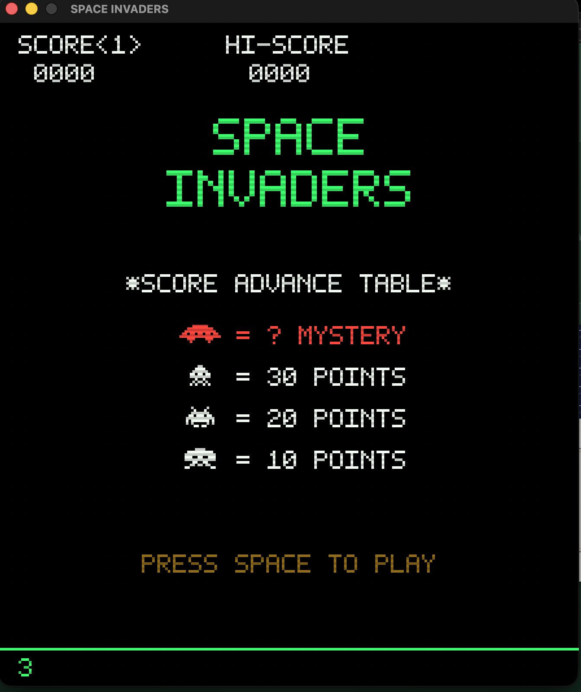
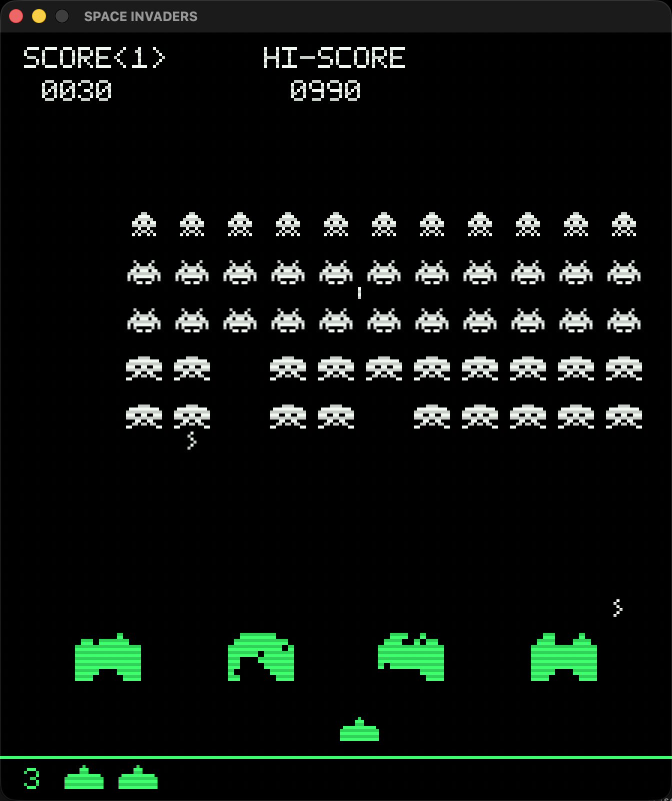

<div align="center">

# 👾 Space Invaders

**A pixel-perfect, native macOS homage to the 1978 arcade classic.**

[](https://github.com/vincentlauriat/SpaceInvaders/releases/latest)
[](#install)
[](https://swift.org)
[](LICENSE)

**[🕹️ vincentlauriat.github.io/SpaceInvaders](https://vincentlauriat.github.io/SpaceInvaders/)**

Runs at the original **224×256 arcade resolution**, upscaled ×3 with crisp
nearest-neighbor pixels. CRT scanlines, a hand-made 5×7 bitmap font, 8-bit
square-wave sounds — and the famous four-note bass march that speeds up as
the invaders close in.

| Title screen | Gameplay |
|:---:|:---:|
|  |  |

</div>

## ✨ Features

- 🕹️ **Authentic gameplay** — 11×5 invader grid (squid 30 pts, crab 20 pts, octopus 10 pts) with 2-frame animations, accelerating block movement, and the original *one player shot on screen at a time* rule
- 🛡️ **Destructible shields** — 4 bunkers eroded shot by shot, chewed through by descending invaders
- 🛸 **Mystery UFO** — crosses the top of the screen with its warbling siren and a random bounty
- 🔊 **8-bit sounds** — every effect is a code-generated square wave, including the four-note march
- 🖥️ **CRT look** — scanline overlay, phosphor-green and gel-overlay tints like the original cabinet
- 🏆 **Hi-score** persisted between sessions, extra life at 1500 points, waves starting lower each level
- 🔄 **Auto-updates** via [Sparkle](https://sparkle-project.org) — signed, notarized, stapled

## 🎮 Controls

| Key | Action |
|---|---|
| ← / → | Move the cannon |
| Space | Fire / start game |
| P | Pause |
| M | Mute |
| Esc | Back to title |

## 📦 Install

Download the latest DMG from the
[**Releases page**](https://github.com/vincentlauriat/SpaceInvaders/releases/latest),
open it and drag **Space Invaders** into **Applications**. The app is
Developer ID signed and notarized by Apple; updates arrive automatically
through Sparkle.

## 🔧 Build from source

Everything in `Resources/` (sounds **and** the app icon) is generated by a
pure-stdlib Python script — there are no hand-drawn binary assets.

```bash
brew install xcodegen
python3 Scripts/generate_assets.py     # regenerate WAVs + AppIcon.icns (optional, committed)
xcodegen generate
xcodebuild -project SpaceInvaders.xcodeproj -scheme SpaceInvaders \
  -configuration Release -derivedDataPath build build
open build/Build/Products/Release/SpaceInvaders.app
```

## 🗂 Project layout

```
Sources/            Swift — AppKit shell + SpriteKit game
  GameScene.swift     game loop, collisions, waves, UFO, shields
  Sprites.swift       1978-faithful pixel patterns ('#'/'.' bitmaps)
  PixelFont.swift     hand-made 5×7 bitmap font
  Pixel.swift         bitmap → nearest-neighbor SKTexture
  SoundManager.swift  8-bit WAV playback + march sequencer
Resources/          generated: Sounds/*.wav, AppIcon.icns
Scripts/            generate_assets.py, release.sh (sign + notarize + Sparkle)
project.yml         XcodeGen spec
appcast.xml         Sparkle update feed
```

## 🗺 Roadmap

- [x] v1.0 — full game, signed & notarized DMG, Sparkle auto-updates
- [ ] Two-player alternating mode, like the cabinet
- [ ] Options menu (volume, scanline intensity)

## 📜 License

[MIT](LICENSE). *Space Invaders* is a trademark of TAITO Corporation — this
is an unofficial fan homage, built for fun and nostalgia.
